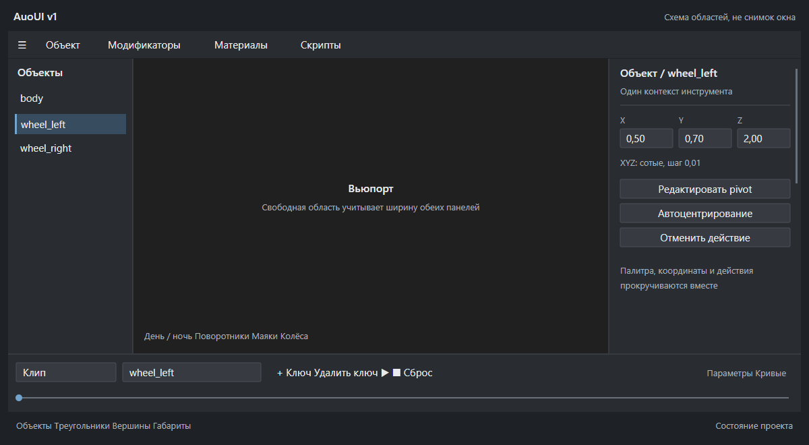

# AuoUI v1 и подготовка редактора

23 октября 2026. Исходный код `ff4f816` (основные изменения `245e5f6`), Aurora 0.2. Владелец разрешил разработку собственного окончательного слоя дизайна поверх WinUI, XYZ до сотых и оптимизацию загрузки. Уточнён медленный раздел: «Параметры транспорта».

## Подготовка данных при запуске

Вместо переноса всей работы в блокирующий экран запуска введена фоновая подготовка справочников после готовности вьюпорта. Открытие параметров и прогрев ожидают одну задачу, а не параллельно сканируют игру. Повторные обращения используют уже подготовленный объект каталога.

Между запусками хранится производный каталог: типы и назначения транспорта, страны, локализация, ресурсы, параметры и звуковые пресеты. Папка `%LOCALAPPDATA%/Aurora/cache/catalog`; игровые файлы не переписываются. Снимок привязан к папке игры, языку, версии Core-модуля и списку исходных скриптов/BTF с размером и временем изменения. Добавление/удаление транспорта и DLC, изменение скрипта или локализации приводят к пересборке. Это кэш разобранных данных, а не изменение исполняемого кода игры.

Снимок записывается через отдельный временный файл и замену. Если файлы изменились во время построения, снимок не публикуется. Повреждение кэша или недоступность его папки не блокируют редактор: каталог строится обычным путём. В настройках есть «Обновить справочники» с принудительной пересборкой, в том числе для файлов с намеренно сохранёнными размером и timestamp. Проверка метаданных не объявляется содержательным хэшированием всех игровых файлов.

DDS-декодирование перенесено с UI-потока в рабочую задачу. Все текстуры и модели игры при старте не загружаются: это увеличило бы потребление памяти и конкурировало с открытием проекта.

## Измерения

Один и тот же локальный набор: **1073 модели, 1075 исходных файлов**, русский каталог, Release. Повторяемая команда из исходников:

```powershell
dotnet run --project Aurora.Tests/Aurora.Tests.csproj -c Release -- --catalog-benchmark <media_soviet> <каталог_кэша>
```

Пять повторных пар замеров:

| Работа | Медиана |
|---|---:|
| Повторный полный разбор исходных файлов | 240,36 мс |
| Проверка и чтение готового кэша | 57,75 мс |

Первое построение с проверкой источников и записью снимка: 456,10 мс. Первоначальный отдельный baseline без кэша: 315,2 мс. Это разные сценарии; улучшение примерно в 4,2 раза относится только к повторному чтению каталога, не к запуску всего приложения или открытию всей формы. Файловый кэш Windows не очищался; это не cold-boot benchmark.

Для самой формы добавлен отдельный запуск `Packaging/test-editor-parameters.py <app/Aurora.Launcher.exe> <media_soviet>`. Он создаёт настоящее дерево WinUI «Параметров транспорта» на тестовом полицейском автомобиле, использует настоящий каталог, измеряет создание и Measure/Arrange три раза и не активирует окно. Это измерение CPU-конструирования формы, а не время её первого видимого кадра.

В обычной работе экспорт диагностики теперь содержит Catalog и PanelOpenings: время от начала команды до первого ContentDialog.Opened, число открытий, последнее и максимальное время. Время последующей работы пользователя в окне в этот показатель не входит. Вызовы системных file/folder pickers сбрасывают замер, чтобы не включать ожидание выбора пользователя. Эти метрики нужны для выявления задержек, которые не объясняются каталогом.

## AuoUI v1: единый договор дизайна

Основа — нативные ввод, фокус, клавиатура, доступность и оконная система WinUI. AuoUI владеет палитрой, размерами, плотностью и расположением инструментов. Это рабочий слой кода, а не только картинка нового оформления.

Приняты правила:

- Нейтральные непрозрачные поверхности, прямые панели, углы 2 DIP. Фоновая Mica редактора убрана. Основной акцент — приглушённый синий; он отмечает действие/выбор, а не украшает каждую область.
- Кнопка 26 DIP, поле 28 DIP, основной шрифт 12 DIP. Компоновка и отступы согласованы через `AuoUI.cs`; нативные шаблоны не заменены рисованными имитациями.
- Верх: меню и частые команды. Слева: список объектов. Справа: общий инспектор активного инструмента, его цель, координаты и действия. Снизу: таймлайн и компактная строка статистики/габаритов.
- Вьюпорт занимает центральную область сетки. Боковые панели и таймлайн отнимают своё пространство при компоновке, а не закрывают часть модели поверх её прежней области. Кнопки тестирования привязаны к нижнему левому углу самого вьюпорта.
- Инспектор и слои занимают высоту своей области. Палитра, XYZ и действия прокручиваются одним потоком. Название объекта/дорожки видно в заголовке инспектора.
- Таймлайн сохраняет перенос команд и отдельные дополнительные параметры. Большие формы используют общий адаптивный контейнер с вертикальной прокруткой.
- Учитываются светлая/тёмная темы и системная высокая контрастность. Реальная приёмка всех масштабов Windows остаётся отдельной проверкой.

```text
Меню и инструменты
┌────────────┬───────────────────────────┬────────────────────┐
│ Объекты    │                           │ Инструмент / цель  │
│            │          Вьюпорт          │ Палитра            │
│            │                           │ X     Y     Z      │
│            │ Тесты                     │ Действия           │
├────────────┴───────────────────────────┴────────────────────┤
│ Таймлайн: клип, дорожка, ключи, воспроизведение, шкала       │
└────────────────────────────────────────────────────────────┘
Объекты / треугольники / вершины / габариты / состояние
```

От 3ds Max взята организация scene explorer, command panel и нижней области времени/статуса; от Blender — принцип областей, которые не перекрывают рабочую сцену, и локальный контекст инструмента. Собственный редактор не объявляется клоном всего рабочего пространства Max/Blender: произвольного разбиения окон и drag docking в этой версии нет.

## XYZ до сотых

Числовые поля XYZ инспектора и координатные поля общих форм показывают две цифры после запятой, шаг 0,01. Округление отображения — до сотых; сохранённые неотредактированные значения не переписываются массово. Выбор шага поворота остаётся отдельным параметром. FOV сохраняет прежнее целочисленное правило.

## Проверка

444 Core-проверки, включая восстановление/инвалидацию/повреждение/недоступность кэша, язык и принудительное обновление. JS и настоящий WebGL2 прошли. В signed hidden WinUI проверяются формат XYZ, native theme, отдельная центральная область вьюпорта, общий док, предыдущие сценарии pivot/выбора/истории и размеры таймлайна.

Интерактивное открытие формы владельцем на его проекте, первый видимый кадр, многоэкранные DPI и субъективная оценка внешнего вида не подменяются скрытым тестом. Новое оформление применяется ко всему общему слою редактора; возможные частные панели проверяются дальше по конкретным наблюдениям владельца.

## Первичные источники правил

- [Microsoft: измерять запуск и взаимодействия отдельно, откладывать необязательную работу](https://learn.microsoft.com/en-us/windows/apps/develop/performance/).
- [Microsoft: стоимость XAML и отложенное создание элементов](https://learn.microsoft.com/en-us/windows/apps/develop/performance/optimize-xaml-loading).
- [Autodesk: состав интерфейса 3ds Max](https://help.autodesk.com/cloudhelp/2026/ENU/3DSMax-Basics/files/GUID-F8326C68-F2F9-47F7-AC1D-BA41D7825C7C.htm).
- [Blender: неперекрывающиеся области и контекст](https://developer.blender.org/docs/features/interface/human_interface_guidelines/paradigms/).


## Подтверждённый комплект

Чистый production `build-363a7400687841c2bb1b5961bb5f5fa0`, source `ff4f8165571c29268dda34d2f70dc178f839e651`, `ModifiedSources=false`, `DevelopmentSigning=false`, 0.2. Встроенные package/signature/tamper и signed hidden WinUI проверки прошли. Первая промежуточная сборка остановилась на ошибке ранней подписки AccessibilitySettings.HighContrastChanged; подписка перенесена на Loaded с безопасным fallback для host, не предоставляющего событие. Неудачный промежуточный комплект не устанавливался.

Проверка настоящей формы транспорта в этом комплекте: 31 control, 1073 записи каталога. Создание и Measure/Arrange: **122,40 / 96,47 / 93,84 мс**, из них Measure/Arrange **85,40 / 88,14 / 86,04 мс**. Чтение каталога в этом отдельном процессе: 265,77 мс. Окно не активировалось. Это не измерение ContentDialog.ShowAsync или первого видимого кадра и не основание объявлять все задержки владельца устранёнными.

Сохранены повторяемые тесты и [машинные результаты](../audit-data/auoui-2026-10-23/measurements.json). В работающем Editor остаётся замер первого Opened для дальнейшей проверки точного проекта владельца.

## Схема AuoUI

Это схема реализованных областей и правил, а не снимок запущенного редактора:




## Доставка и установка

Готовый общий ZIP Launcher + Editor, соседний Setup и контрольные суммы сохранены в `C:/Users/AVR/Downloads/Aurora-0.2-AuoUI-2026-10-23`. Публикация нового GitHub Release/tag не выполнялась.

На момент подготовки отчёта запущен установленный Editor, который держит заменяемые файлы. Владельцу отправлен запрос закрыть Editor/Launcher. **Новый комплект ещё не установлен**; установленная версия остаётся предыдущей. После подтверждения закрытия необходимо выполнить транзакционную установку, сверить hashes с package и повторить installed hidden WinUI check. Не закрывать работающий пользовательский Editor принудительно.
