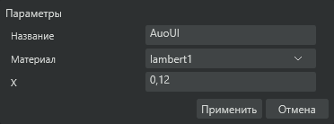

# AuoUI workflow corrections — 2026-10-23

Owner-authorized continuation of the working design. Native WinUI remains the base; product version remains 0.2. No Release or tag is created.

## Implemented

- Shared separate-dialog host fits the actual AuoUI dialog surface after layout. Short exit confirmations no longer inherit the large default empty native window. Tall forms retain automatic scrolling.
- Native WM_GETMINMAXINFO limits allow shrinking but cap interactive growth at the fitted initial dimensions. Maximize is disabled for dialogs and tool windows. Tool windows also fit short content. Reopening a dialog preserves its host and does not duplicate native windows; idle confirmation hosts are released.
- Main error notice dismisses after five seconds. Every new error restarts the interval, including identical messages. Closing the Editor stops the timer.
- Removed the colored layer-list selection indicator. The neutral selected row remains. Mesh/layer context menus expose Properties and Delete object.
- Transform command activates the existing right inspector. The inspector stays in its viewport region. Light windows contain the light list; transform controls stay in the main inspector. Vehicle tests remain accessible during mesh/pivot editing and mesh picking. Removed redundant wheel steering entry from Modifiers; the vehicle-test control remains.
- Fixed both pivot-only and ordinary object transforms using the shared scene origin instead of the displayed local pivot. An object rotated around its local center retains that center. Escape preserves completed edits and only rolls back an unfinished drag. Explicit object origins and existing undo/redo metadata continue to be respected.
- Wheel diagnostics retain the native-name requirement and component masks. Explicit object pivots override diagnostic origins. During pivot-only editing the running wheel preview uses the live edited axis; immutable-model diagnostics are cached.
- Orientation application rotates around the chosen model pivot instead of translating that pivot to the origin.
- Animations opens the bottom timeline without a mesh picker. Clicking again does not close it. A visible × closes it explicitly; switching tools does not hide the panel. New scene clips include the scene objects, and selecting an object missing from an existing clip adds its track. A key captures all tracks, including simultaneous selected-object draft transforms. Drafts participate in undo/redo. Existing 64-track/native-action constraints remain.
- Floor grid has distinct X/Z origin lines, plus a viewport orientation triad. These helpers do not enter image exports or picking.
- Footer XYZ uses hundredths and synchronizes with the inspector. Position coordinates support world, selected-object local frame, model pivot and another object. The selector controls position; rotation/scale retain their existing object/animation semantics. Move handles use the chosen position basis. Local values are offsets from the current local origin.
- Optional toolbar ghosting keeps the selected object at its normal appearance and renders other objects at 50% opacity. Element selection retains the normal appearance of its owning object. Picking and export previews ignore ghosting.

## Verification before production packaging

- 444 Core checks passed.
- JS viewport suite passed, including simultaneous scene overrides and a live wheel pivot without source geometry movement.
- Isolated real WebGL passed silhouette, through-selection, selected wire color and actual ghosting pixels in object/element modes. Existing camera/export/texture/20 km/h playback checks passed.
- Real signed hidden WinUI construction/layout passed, including selected-object local pivot transforms, scene keys for two targets, history context and compact layout checks.
- Test-owned native windows passed: repeat open/close, automatic scrolling, validation cancel/accept, compact exit confirmation, native size limits, tool reuse and five-second notice reset/dismissal. No user window was activated or controlled.

These automated checks do not establish owner live GUI/DPI acceptance or actual in-game animation acceptance.

## Delivered and installed

Clean production source: `8d513527e5870f6cf3c48e7b398d6230d20110bd`, `ModifiedSources=false`, production signing, version 0.2. Build: `build-1f7df11c22264a42893209aae0cba9ea`.

Native installer fixtures, combined-package integrity/tamper checks, executable branding and module/update signatures passed. Production hidden parameter-form measurement on 1,073 catalog objects: 114–161 ms construction/measure; this does not measure the owner's visible first frame.

Installed transactionally while Aurora was closed in `D:/SteamLibrary/steamapps/common/SovietRepublic/Aurora`. All **577** packaged files match their installed SHA-256. Installed hidden Editor construction and native-window checks passed. The root `Aurora Editor.exe` independently passed forwarding to the real Editor without activation. Backup: `C:/Users/AVR/AppData/Local/Aurora/backups/616580734`. Installation receipt: ignored local `artifacts/workflow-install.json`.

Ready executable copy, also hash-verified: `C:/Users/AVR/Downloads/Aurora-0.2-Workflow-8d51352`. Exactly one Launcher + Editor ZIP and adjacent Setup remain in the production output. No Release/tag was published. Existing unrelated files were preserved; the game was not launched or controlled.

Actual offscreen WinUI test form after fitting, using synthetic field values rather than the owner's vehicle:

