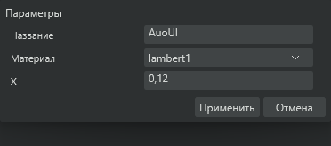

# AuoUI: перенос согласованного дизайна в рабочий Editor

Владелец согласовал плотные мягкие серые окна и поручил сразу собрать рабочую версию. WinUI остаётся основой ввода, доступности и окон; внешний вид кнопок и диалогов принадлежит AuoUI. Продукт остаётся 0.2.

## Что перенесено

- Собственные шаблоны Button и ContentDialog: нейтральные непрозрачные поверхности, без декоративной обводки и системной яркой кнопки. Кнопки и поля 22 DIP, текст 11–12 DIP, интервалы 3–6 DIP. Системный клавиатурный фокус сохранён.
- Формы открываются в отдельных нативных окнах. Сохраняются исходные обработчики, отмена, проверка ошибок и результат Primary/None. Диалог после выбора модели во вьюпорте повторно использует то же окно и XamlRoot. По завершении команды скрытые окна освобождаются.
- Общая плотность применяется к параметрам, материалам, LOD, грузам, звукам, оборудованию, импорту и экспорту. Длинные формы получают вертикальную прокрутку по фактической высоте окна.
- Слои содержат список объектов. Отдельной кнопки редактирования нет. Команды мешей, трансформации, pivot, свойств, переименования, удаления и LOD находятся в верхнем «Объект». ПКМ сохраняет контекстные отделение, переименование и удаление.
- «Анимации» находится непосредственно после «Скрипты» и показывает/скрывает нижнюю панель. В компактной панели остаются клип, параметры, воспроизведение, добавление ключа, текущий кадр, метки ключей и шкала. Имена мешей не занимают панель. Параметры/кривые открываются отдельно. Настройки оси, груза, штатного действия, FPS, интерполяции и управление клипами сохранены.
- Перестроение кнопок ключей кэшируется по дорожке, длине и ширине. Продвижение текущего кадра не создаёт заново весь список ключей.
- Параметры транспорта используют сворачиваемые разделы «Общее», «Назначение и груз», «Движение», «Оборудование», «Звук». Работающие зависимости класса, ресурса, страны, цены и годов сохранены. LOD вынесены в «Объект», включая прицеп/секцию.
- Свет открывается отдельным окном: список слева, координаты и действия справа. Используются прежние реальные обработчики огней и зеркалирования. При смене инструмента элементы возвращаются в общий инспектор.
- XYZ инспектора выровнены вертикальными строками; точность 0,01 сохранена. Лишнее имя объекта в заголовке инспектора убрано. Смена имени в свойствах использует общий обработчик переименования с сохранением ID, скриптов, анимаций, стекла и структуры обмена.

## Где искать код

- `Aurora.Editor/AuoUI.cs`, `EditorDensity.cs`: шаблоны и общие правила плотности.
- `EditorAuoWindows.cs`: отдельные окна, жизненный цикл, свойства и числовая трансформация объекта, окно света, проверка реальных нативных окон.
- `EditorMenus.cs`, `EditorLayers.cs`: навигация и список объектов.
- `EditorAnimation.cs`: компактный таймлайн и отдельные параметры/кривые.
- `EditorModelSettings.cs`, `EditorVehicle.cs`: разделы транспорта и адаптивные формы.
- `Packaging/test-auoui-windows.py`: отдельные окна без активации, повторное открытие, прокрутка, отмена и последующее принятие проверки.

## Проверки и границы

До финальной упаковки проверены 444 Core-проверки, JavaScript/настоящий WebGL2, signed WinUI-конструкция и компоновка. Проверка новых окон создаёт только собственные тестовые окна за пределами рабочего стола через Show(false), не отправляет клавиатуру/мышь и не активирует окно пользователя.

На реальном WinUI проверены два открытия одного диалога, освобождение окон, повторное использование окна инструмента, автоматическая прокрутка длинной формы и вызов Primary через собственный AutomationPeer: первая проверка отменяет закрытие, вторая принимает. Короткая форма полностью помещается без прокрутки. Этот тест включён в сборку перед архивированием.

Проверка не заменяет ручную оценку всех моделей, всех DPI и игровых действий. Новые панели подключены к существующим операциям редактора; это не подтверждение нового поведения игрового движка. Контракт OBJ с отдельным файлом метаданных и ограничения штатных анимаций не изменены.

Скриншот ниже получен RenderTargetBitmap из настоящего тестового окна WinUI, без модели и пользовательских данных. Это не HTML-макет.

Финальный исходный коммит, комплект, проверки подписей и место доставки записываются в следующем разделе после успешной упаковки. Установленная старая версия автоматически этой записью не меняется.
