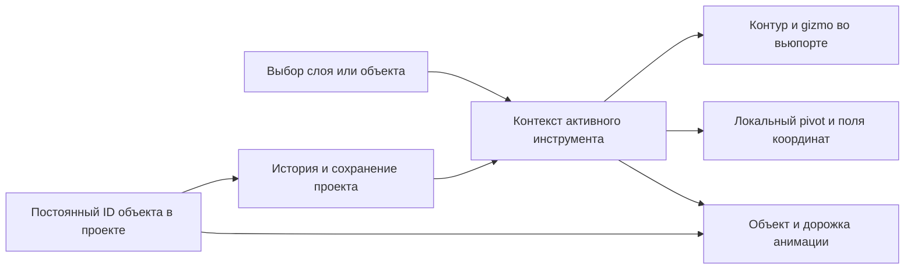

# Aurora Editor 0.2: завершение исправлений по аудиту

23 октября 2026. Запрос владельца: самостоятельно закончить остальные пункты аудита и предоставить отчёт. Этот документ заменяет список оставшихся работ из отчёта первого этапа, но не объявляет прохождение интерактивной приёмки владельцем.

## Результат

Исходники и готовый комплект исправлены. Сохранены native WinUI, версия 0.2, один общий комплект Launcher + Editor и существующая подпись издателя. Свой оконный движок AuaUI не создавался: причина размеров была в теме, явных размерах и компоновке. Для редактора введены общие компактные правила поверх WinUI.

Финальный исходный код: `4384df5`. Предыдущие коммиты этой работы: `ee34e00`, `47fab61`, `7edf58b`. Документация и сведения об установке фиксируются отдельно, чтобы пакет содержал чистый исходный коммит.

## Что теперь связано между собой



Переключение слоя синхронизирует цель анимации. Если у выбранного объекта нет дорожки, редактор предлагает добавить её через «+», а не показывает gizmo другого объекта. Подтверждённый выбор модели сохраняется; отмена возвращает прежний выбор. Выбор детали присоединённой модели не подменяет слой основной модели.

Схема компоновки (схема областей, не скриншот):

```text
Главное меню и команды
┌──────────────┬─────────────────────────────┬──────────────────┐
│ Слои         │                             │ Палитра эффекта  │
│              │          Вьюпорт            │ Координаты       │
│              │                             │ Действия         │
│              │                             │ Общая прокрутка  │
├──────────────┴─────────────────────────────┴──────────────────┤
│ Клип, дорожка, команды с переносом, параметры, график         │
│ Шкала времени                                                │
└──────────────────────────────────────────────────────────────┘
Статистика и габариты модели
```

## Сопоставление со всеми 28 пунктами исходного аудита

«Исправлено» означает выполненное изменение исходников с указанной проверкой, а не обещание отсутствия любых ошибок на любых моделях.

| № | Результат | Проверка или граница |
|---|---|---|
| 1 | Слой, активная дорожка, контур и gizmo синхронизируются; отсутствующая дорожка не заменяется чужой. | Настоящий hidden WinUI: кузов → колесо → отсутствующая цель. |
| 2 | Общая фабрика новых дорожек использует локальный pivot и ориентацию объекта; «+» не задаёт мировой ноль. | Core и hidden WinUI. |
| 3 | Вход из механизма использует его ось и объект; активная дорожка синхронизирует выделение. Источник оси подписан. | Проверены обработчики; игровое действие требует игровой приёмки. |
| 4 | Picker сохраняет подтверждённый объект, отмена восстанавливает старый; возвращается полный контекст инструмента. | Проверка обработчиков и компиляция; интерактивный выбор владельцем отдельно. |
| 5 | Есть явная команда перепривязки pivot старого клипа с историей и сохранением движения по кадрам. | Сравнение мировых матриц на каждом целом кадре, повёрнутая ось и неравномерный масштаб. |
| 6 | У дорожки указан источник Object/Mechanism/Custom. Object следует позиции и ориентации frame; Custom остаётся независимой. | Native-проверка изменения локальной оси и неизменности пользовательской. |
| 7 | Активный режим задан EditorToolContext; поля и gizmo читают тот же режим и дорожку. | Native-проверки взаимоисключения режимов. |
| 8 | Удалена повторная установка видимости обычной кнопки pivot; она скрыта в анимации. | Обработчики и WinUI construction. |
| 9 | В анимации действует её режим оси; обычная объектная кнопка скрыта. Checkbox синхронизируется при смене/восстановлении дорожки. | Компиляция и native-контекст. |
| 10 | Обновление интерполяции при выборе дорожки защищено animationUpdating. | Проверены обработчики; смена сама по себе не коммитит кривую. |
| 11 | Ограничение обозначено как «Единственный родитель груза». | Один родитель в клипе сохранён как явное правило. |
| 12 | История хранит клип, объект, кадр, режим оси и контекст инструмента. Новый snapshot не подменяется текущим режимом. | Native-проверки mesh undo/redo и отсутствия самопроизвольного возврата анимации. |
| 13 | Общие компактные стили кнопок, полей, списков и переключателей. | Настоящий Button: desired height ≤28,1 DIP. |
| 14 | Изменены ресурсы темы, padding, min sizes и font; нативные шаблоны сохранены. | Компиляция с закреплённым SDK, construction и Measure/Arrange. |
| 15 | Команды таймлайна переносятся по ширине. | Native Measure/Arrange 512, 640, 800, 1024, 1200, 1536 DIP. |
| 16 | Удалена общая горизонтальная прокрутка низкой строки таймлайна. | Native-проверка границ контролов. |
| 17 | Grid имеет отдельные области слоёв, дока и нижнего таймлайна; отступ 208 не нужен. | Проверка дерева и геометрии WinUI. |
| 18 | Дополнительные параметры анимации расположены вертикально. | Компиляция и construction. |
| 19 | Ширина графика ограничивается доступной областью; обновление графика кэшируется. | Проверка обработчиков и сборка. |
| 20 | Палитры, координаты и действия помещены в общий правый поток с Auto-прокруткой. | Native проверяет все четыре дочерних блока и общий ScrollViewer. |
| 21 | PBR использует общее адаптивное окно VehicleDialog; убран отдельный фиксированный контейнер. | Сборка; обычный material flyout ограничен 260–360 DIP. |
| 22 | Проверены размеры в DIP, устранены конкретные ограничения компоновки и контролов. | Отдельная матрица реальных мониторов/масштабов 100/125/150/200% пока не пройдена. |
| 23 | Двухэтапная классификация оставлена по прямому указанию владельца. | Это категория TYPE и конкретное назначение/игровой класс; не два одинаковых поля. |
| 24 | Явные режимы «название» и «ID локализации»; запись NAME/NAME_STR не переключается скрытно. | Core: оба направления, отсутствие конкурирующей директивы, скобки в реальном имени, неверный ID. |
| 25 | Из настроек модели открывается единый редактор звуков; параллельный embedded-редактор удалён. | Сборка и проверка пути сохранения. |
| 26 | Основной дым из разных меню ведёт в ConfigureSmoke; присоединённый дым остаётся отдельной игровой сущностью. Свет использует общую палитру. | Проверены точки входа и типизированные параметры. |
| 27 | PBR применяется без Display; выбор/трансформации/анимация используют адресные каналы, груз — replaceCargo. Добавлены счётчики реальной работы. | JS подтверждает: повторное выделение не пересоздаёт сцену и не загружает геометрию. Полная загрузка документа/структурные правки сохраняют Display. |
| 28 | Режимы mesh/animation/light/cargo/smoke/mechanism/camera собраны в EditorToolContext, история его сохраняет. | Native проверяет переходы; busy/processing остаются флагами выполнения, а не режимами редактирования. |

## Важные детали совместимости

- Старые клипы не исправляются молча: их сохранённый pivot считается пользовательским. Перепривязка запускается явно и отменяется через историю.
- «Сохранить движение по кадрам» запекает ключ на каждом целом кадре, до 10001 ключа. Это сохраняет матрицы целых кадров и игровых экспортных samples. Между целыми кадрами возможны отличия от исходной кривой. Без галочки остаются редкие исходные ключи, но движение относительно нового pivot меняется.
- Постоянные ID и метка явно заданного нулевого pivot хранятся в .aur и истории. Переименование не меняет ID. Новым отделённым деталям назначаются свои ID. В игровых NMF/INI имена остаются обязательным контрактом; UUID не подменяет имена колёс.
- Явно установленный pivot в мировом нуле не заменяется автоматически центром bounds. Для старого NMF без такого признака сохранён прежний fallback по геометрии.
- Штатные действия транспорта сохранены; произвольная система игровых триггеров, skinning и импорт произвольных FBX-анимаций не добавлялись.
- Одна только высокая плотность controls не является доказательством полной доступности на всех DPI. Тема сохранена нативной, но нужна приёмка на фактическом мониторе владельца.

## Дополнительная проверка 3ds Max

В отдельном batch-процессе настоящего 3ds Max 2024 проверен Exchange/max_aurora.py. Уже открытая пользовательская сцена не использовалась. Найдены и исправлены два дефекта, пропущенные тестами конвертера: неподдерживаемый transpose(matrix3) и повторное применение transform к snapshotAsMesh, который уже содержит мировые координаты.

Тестовая сцена содержит повёрнутый и смещённый mesh и дочерний dummy. После OBJ+JSON обмена сравнены имена, parent, frame, вершины, нормали, UV, индексы, группы, материал и metadata. Максимальная погрешность 1,94×10⁻⁷, порог 10⁻⁴. В репозитории оставлена повторяемая проверка Packaging/test-max-exchange.py.

Blender не найден. Этот результат не доказывает работу штатного FBX-плагина Max, произвольных сглаженных моделей, других версий DCC или самих игровых действий.

## Проверки

- 434 Core-проверки, включая математическую перепривязку, .aur ID/метаданные, NAME/NAME_STR, ограничения и split-ID.
- JS regression: выбор, режимы outline/wireframe, старые/новые позы, разные pause/reset, счётчики обновлений.
- Настоящий WebGL2 в отдельном headless Edge: shaders, silhouette, выделение сквозь геометрию, цвет выбранной сетки.
- Подписанный WinUI: construction, режимы, история, explicit-zero pivot, ID при переименовании, перенос команд и размеры.
- Production package: подписи, содержимое, tamper-проверки и hidden startup встроены в build.ps1.
- Настоящий 3ds Max 2024 batch exchange, описанный выше.

Детальные журналы находятся в игнорируемой artifacts/remainder-*.log. Они не содержат приватный ключ издателя. Игровые originals и открытая пользовательская сцена Max не изменялись.

## Что нельзя считать завершённой приёмкой

1. Визуальная работа владельца во всех меню на реальных масштабах Windows и нескольких мониторах.
2. Blender и штатный FBX-обмен конкретных версий Blender/Max.
3. Запуск всех штатных анимаций транспорта в игре и реальный Steam Play.
4. Измерение FPS/времени на больших пользовательских моделях. Сейчас есть счётчики и конкретные устранённые лишние обновления, а не доказанная процентная прибавка производительности.

Кодовые изменения по аудиту выполнены; перечисленные границы проверки не скрыты за общим PASS. Установка, финальный build ID, hashes и резервная копия приведены ниже после завершения комплекта.


## Установка и доставка

Установлен чистый production `build-f1ba3298f319414bb39c1487a1ee95ad`, исходники `4384df5849c2f013f6c0064e0d109f636ed42fd5`, `ModifiedSources=false`, `DevelopmentSigning=false`, версия 0.2. Финальный build.ps1 завершился с exit 0; встроенные package/tamper/signature и signed WinUI проверки прошли.

Aurora была закрыта. Транзакционная установка выполнена в `D:/SteamLibrary/steamapps/common/SovietRepublic/Aurora`. Все **581** установленный файл сверены по SHA-256 с package. Уже установленный `app/Aurora.Launcher.exe --editor-startup-check` прошёл скрытую проверку Editor без активации окна.

Резервная копия: `C:/Users/AVR/AppData/Local/Aurora/backups/605104500`. Готовый комплект: `C:/Users/AVR/Downloads/Aurora-0.2-EditorAudit-2026-10-23`. В нём один общий ZIP, соседний Setup, update manifest и SHA256SUMS. Запуск редактора: `D:/SteamLibrary/steamapps/common/SovietRepublic/Aurora/Aurora Editor.exe`.

Машинная квитанция установки хранится локально в `artifacts/remainder-install.json`. Эта работа не публикует GitHub Release или новый tag.
