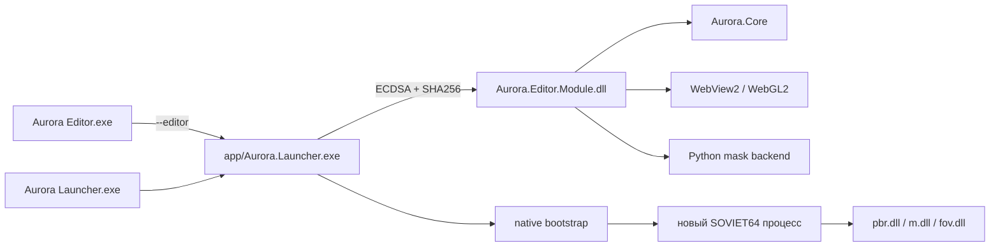
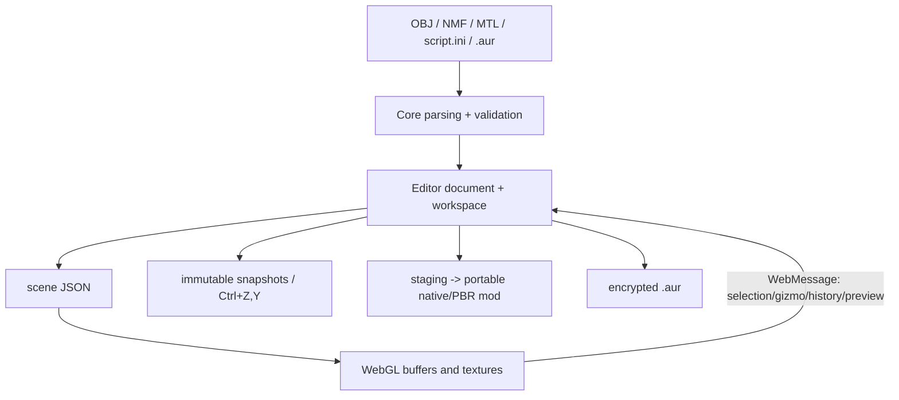

# Архитектура и границы

## Процессы и пакет

Одинаковое имя процесса **Aurora.Launcher.exe** при работе Editor нормально: это общий WinUI/.NET host. Окно Launcher вместо Editor при `--editor` нормально не является. Editor загружается отражением из подписанного bundled module; самостоятельная папка runtime для него не дублируется.

## Подсистемы

| Подсистема | Ответственность и основные файлы |
| --- | --- |
| WinUI host | `Aurora.Launcher/App.cs`, preferences, экраны, открытие Editor; `EditorHost.cs` проверяет manifest до reflection load |
| Shared chrome | `Shared/WindowChrome.cs`, `WindowSizing.cs`: caption, рабочая область, DPI, размеры |
| Core | Форматы, безопасные пути, импорт, проекты, script, зависимости, модули; без зависимости от WinUI |
| Editor state | partial `EditorWindow` в `Aurora.Editor/*.cs`; интерфейс и документ связаны через это состояние |
| Viewport | `Assets/viewport.html`, `gizmo.js`, `previews.js`, встроенные при загрузке; WebGL2 buffers/textures/selection/camera |
| Межпроцессный game bootstrap | `Aurora.Bootstrap`, `Native`: запуск нового процесса и повторная проверка разрешённых DLL |
| Entry/Setup | `Aurora.Setup.Native/Entry.cpp`, `Setup.cpp`: native root EXE, установка, rollback, Steam bridge |
| Подписи | `Aurora.Publisher`, `ModCatalog`, `UpdateService`, `WorkshopUpdates`, `ModuleRuntimeCompatibility` |
| Маска стекла | `Backend/mask_backend.py`, связанные cooker/code; PyInstaller onedir, не пользовательский Python |
| Graphics | Отдельный repo GameData: PBR renderer, VFS, engine adapters, native texture/material/model hooks |
| FOV | `Modules/FovChanger` — независимая DLL с pin executable hash и проверкой таблицы камеры |

## Данные и события Editor

`Display()` — полное построение сцены и подгрузка карт. Не вызывать его на каждом кадре анимации или при выборе другого груза. Cargo-only update заменяет cargo nodes/resources. Mechanism/wheel/keyframe pose меняет только соответствующие вершины/нормали существующих VAO. Undo и смена документа могут требовать полного восстановления.

WebView имеет CSP, разрешает только точный загруженный документ и data images, запрещает внешнюю навигацию. Message handlers обязаны проверять числа/индексы и состояния. Сцена и preview используют отдельные ограничения загрузок/ресурсов.

## Состояния, которые нельзя смешивать

- `busy`: команда ещё не завершена; это не всегда вычисление.
- `processing`: действительно идёт обработка; progress виден только при busy+processing.
- `meshPick`: команда ждёт пользователя; viewport обязан получать ввод несмотря на busy.
- `animationEditing`, `cameraEditing`, `gizmoVisible`, `transportPoint`: отдельные режимы, не новые копии документа.
- `selectedLod` и основной объект: счётчики/выбор относятся к текущей модели; экспорт охватывает требуемые модели/LOD.
- `workspaceDocuments` хранит несколько самостоятельных транспортных объектов внутри одного проекта. Это не список мешей.

## Технический долг

Крупные partial-классы и однострочные обработчики затрудняют review и допускают пропуск attachment/ошибки режимов. Будущий рефакторинг: отдельно model/session, viewport command bridge, tool mode state machine и WinUI views. Сначала тесты сохранения/переходов, затем перенос кода малыми шагами; косметический wholesale rewrite не требуется.
